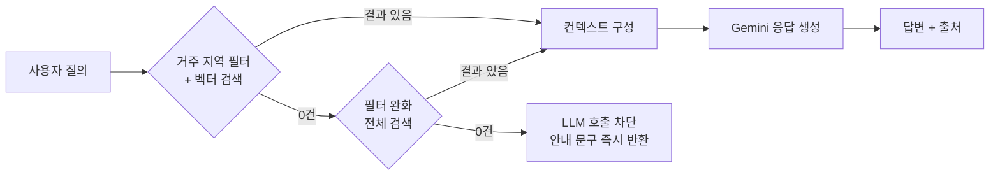

# Youth-Link

청년정책 상담 서비스. 모델의 기억이 아니라 **검색된 공고를 근거로만** 답한다.

> 청년정책은 매달 쏟아지지만 정작 필요한 사람에게 닿기 전에 여러 사이트와 공고 속에 묻힌다.
> 잘못된 정보 하나로 신청 시기를 놓치면 그 정책은 그 사람에게 없는 것과 같다.
> 그래서 "아는 척하며 틀리는 것"을 가장 큰 실패로 두고 설계했다.

|  |  |
| --- | --- |
| 기간 | 2026.03 ~ 2026.07 |
| 구성 | 백엔드 2명 |
| 백엔드 | Java 21 · Spring Boot 3.4 · Spring AI 1.1 · Gemini · Chroma · MySQL |
| 프론트엔드 | Next.js 15 · TypeScript · Tailwind CSS v4 |
| 데이터 | 온통청년 공공 API(국가 청년정책 통합 플랫폼) |

---

## 설계 1 — 환각을 프롬프트가 아니라 코드로 막는다

"모르면 모른다고 답하라"는 시스템 프롬프트는 **요청이지 강제가 아니다.** 모델이 무시하면 그만이다.
그래서 검색 결과가 비면 LLM 호출 경로에 **진입하지 않도록** 코드에서 막았고, 시스템 프롬프트는
2차 방어선으로 두었다.



근거가 없으면 답을 만들 기회 자체가 없다. 덤으로 답할 수 없는 질문에 드는 토큰 비용도 0이 된다.

이 보장은 테스트로 고정했다 —
[`ChatServiceEvidenceGuardTest`](src/test/java/com/youthlink/server/chat/ChatServiceEvidenceGuardTest.java)가
`verifyNoInteractions(chatClientBuilder)`로 **LLM 호출 경로에 진입조차 하지 않음**을 검증한다.

## 설계 2 — 유사성과 자격은 다르다

임베딩은 의미의 유사성은 잡아도 자격 조건의 일치는 잡지 못한다. `월세 지원`을 검색하면
서울 정책과 부산 정책이 비슷하게 잡히는데, **서울 거주자에게 부산 정책을 주면 검색은 성공해도
서비스는 실패다.**

그래서 임베딩 시 대상 지역을 메타데이터로 함께 저장해 검색 단계에서 먼저 걸러낸다.
다만 이렇게 거르면 결과가 0건이 될 수 있어, 그때는 필터를 완화한 전체 검색으로 자동으로 넓히는
2단계 폴백을 두었다.

지역 메타데이터는 법정동코드에서 환원한다 — 공공 API가 시/도 명칭 대신 법정동코드만 내려주기
때문이다. 정책 하나가 여러 시/도를 대상으로 할 수 있는데 Chroma 메타데이터 값은 스칼라만
허용해 "목록에 포함되는가"를 질의할 수 없어, `region_<코드>=true` 불린 키로 전개해 저장한다.
→ [`RegionMetadata`](src/main/java/com/youthlink/server/domain/policy/support/RegionMetadata.java)

## 설계 3 — 바뀐 것만 다시 임베딩한다

매일 전량 재임베딩은 낭비다. 공공 API의 사업 ID를 자연키로 삼아 12개 필드를 비교해 실제로
바뀐 정책만 하류로 넘긴다. 같은 변경 목록을 알림 생성에도 재사용해 중복 알림까지 구조적으로 막았다.
Document ID를 사업 ID에 고정해 재적재가 중복 삽입이 아니라 덮어쓰기가 되게 했다.

---

## 담당

**RAG 파이프라인 · 환각 차단 · 2단계 폴백 검색 · 회원 프로필/대화 이력 API**를 설계하고 구현했다.
증분 수집 배치는 팀원이 구현했고, 공공 API 스펙이 XML에서 JSON으로 바뀌었을 때 증분 비교 구조를
유지한 채 데이터 소스를 교체하는 작업을 맡았다.

프론트엔드는 백엔드 완료 후 단독으로 구현했다.

## 자체 점검에서 찾아 고친 것

서비스를 다시 열어보며 **설계 의도와 실제 동작이 어긋난 지점 3곳**을 찾아 고쳤다.
각 버그는 독립 커밋으로 분리했고 원인과 영향을 커밋 본문에 남겼다.

| 증상 | 원인 |
| --- | --- |
| 변경된 정책이 DB에 반영되지 않고 매번 재임베딩 | 같은 빈의 메서드를 자기 호출해 트랜잭션 프록시를 우회 |
| 새벽 2시 수집 배치가 한 번도 실행되지 않음 | `@EnableScheduling` 애노테이션 누락 (import 만 존재) |
| 지역 필터가 항상 0건 → 개인화 소실 | 거주지(시/도)와 정책 운영기관명을 동등 비교 |

자세한 내용은 [docs/2026-11-26-review.md](docs/2026-11-26-review.md).

---

## 실행

### 프론트엔드만 (백엔드 없이)

```bash
cd frontend && npm install && npm run dev
```

`http://localhost:3000`. 기본값이 목(mock) 모드라 MySQL·Chroma·Gemini·카카오 OAuth 없이
화면 전체가 동작한다. 목은 응답 계약뿐 아니라 RAG 분기까지 흉내 내므로,
정책과 무관한 질문(`비트코인 투자 방법 알려줘`)을 넣으면 환각 차단 동작을 볼 수 있다.

### 백엔드

```bash
docker run -d -p 3307:3306 -e MYSQL_ROOT_PASSWORD=비밀번호 -e MYSQL_DATABASE=youth_link mysql:8
```

```bash
docker run -d -p 8000:8000 chromadb/chroma
```

```bash
./gradlew bootRun
```

`.env.properties`에 `MYSQL_PASSWORD` · `GEMINI_API_KEY` · `YOUTH_CENTER_API_KEY` ·
`JWT_SECRET` · `KAKAO_CLIENT_ID` · `KAKAO_CLIENT_SECRET`이 필요하다.
API 문서는 `http://localhost:8080/swagger-ui.html`.

```bash
./gradlew test
```

## 구조

```
src/main/java/com/youthlink/server/
  common/        공통 응답·예외, Security(JWT·OAuth2), Gemini 임베딩 설정
  domain/
    chat/        RAG 상담, 대화 이력          ← 환각 차단·2단계 폴백
    policy/      수집·증분 배치·임베딩         ← RegionMetadata, PolicyUpsertService
    member/      프로필 (검색 필터의 입력값)
    notification/ · policyalert/ · region/ · auth/
frontend/        Next.js 15 (frontend/README.md)
```

## 알려진 제약

화면에서 우회하지 않고 그대로 드러냈다.

- 정책 목록 API에 페이징과 신청기간이 없어 마감 임박 정렬을 붙일 수 없다
- 세션 목록 API가 없어 대화방 목록을 브라우저에 보관한다
- 나이·소득·고용 조건은 아직 하드 필터가 아니라 프롬프트 참고값이다
- 수집 API에서 사라진 정책을 만료 처리하지 않는다

다음 과제는 [docs/2026-11-26-review.md](docs/2026-11-26-review.md)에 우선순위와 함께 정리했다.
